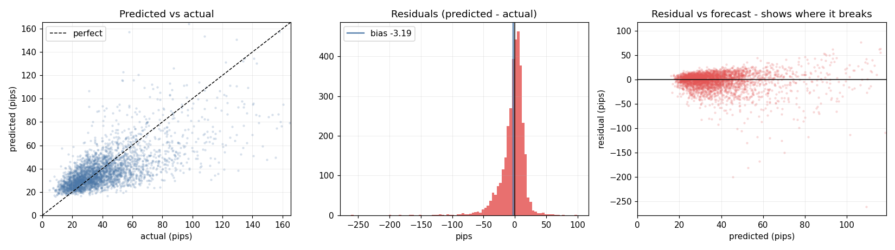
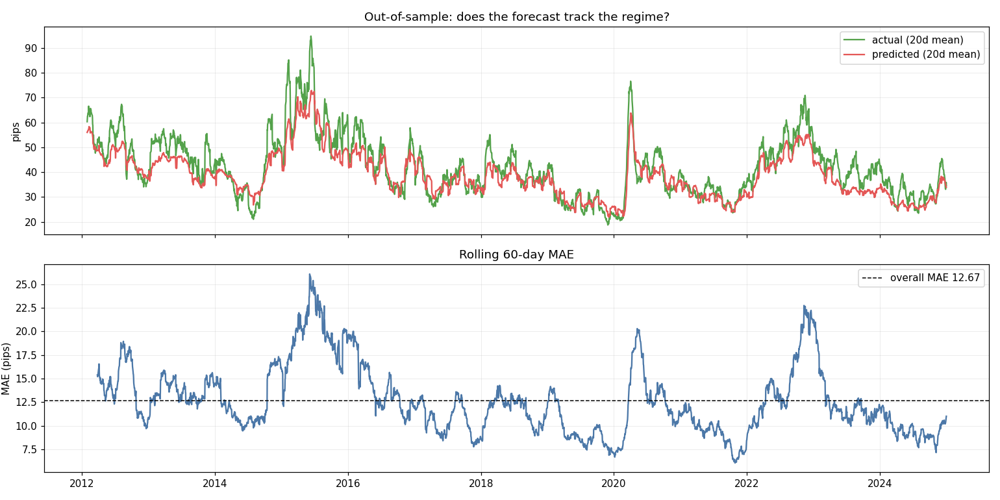
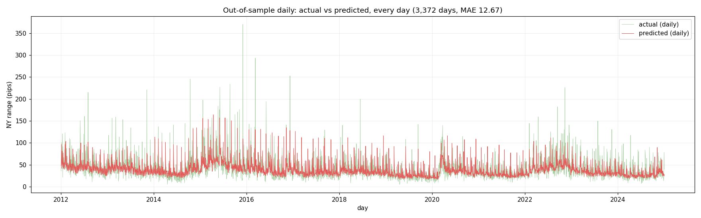
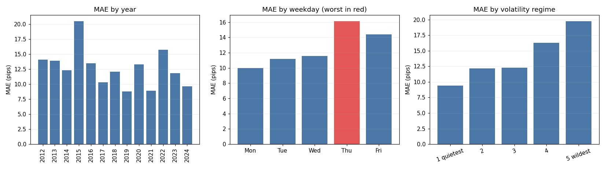
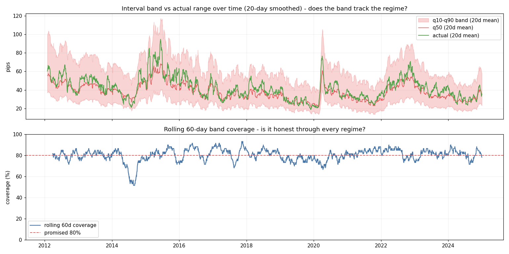
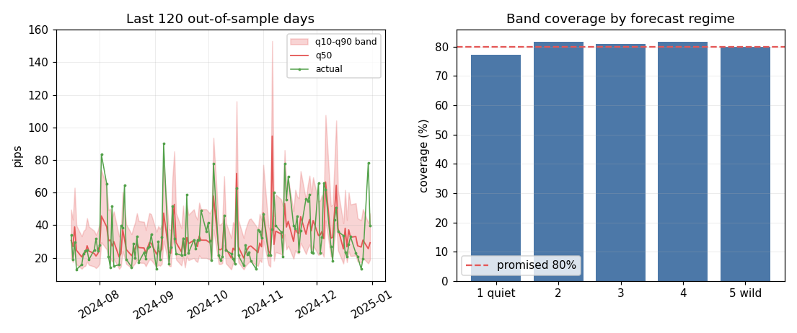
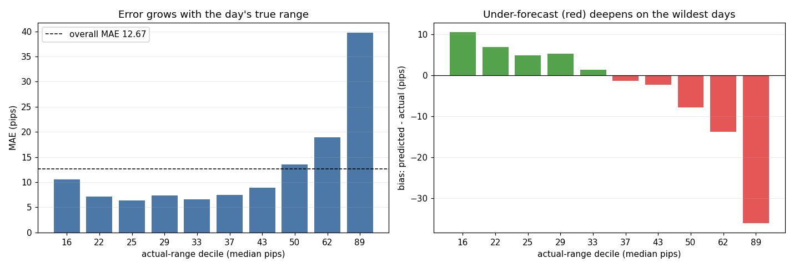

# EUR/USD Session-Range Forecast

A machine-learning model that forecasts how far EUR/USD will move around the
New York open, with calibrated prediction intervals.

Every morning at 07:00 New York time, using only data available up to that
moment, the model answers one question:
**how wide will the 07:00–10:00 trading range be today?** The answer comes as
a point forecast and an interval: on a typical day, *"about 34 pips, 80%
likely between 21 and 56"*.

This repository publishes the model's **out-of-sample results**: every
forecast, every interval and the evaluation report. The feature engineering
and model code are kept private.

---

## Headline results

Out-of-sample walk-forward, **3,372 trading days (2012–2024)**:

| | MAE (pips) | RMSE (pips) | r² | Spearman ρ |
|---|---|---|---|---|
| **RBF-SVR (selected model)** | **12.67** | **20.16** | **0.431** | **0.659** |
| 20-session median baseline | 15.60 | 25.57 | 0.084 | 0.444 |
| Exponentially weighted mean baseline | 16.40 | 24.99 | 0.126 | 0.445 |
| Yesterday's range baseline | 21.55 | 33.33 | −0.555 | 0.278 |

- **19% lower error** than the 20-session median baseline (12.7 vs 15.6 pips MAE).
- **Beats the baseline in every one of the 13 test years**, not only on average.
- **Calibrated intervals:** the 80% band (q10–q90) contains the actual range on
  **80.3%** of days, and every quantile lands within 1.1 percentage points of its target.

---

## The problem

The 07:00–10:00 New York window is one of the most active parts of the EUR/USD
day.
London is still open, major US data is released at 08:30 and US equities open
at 09:30. How large that window's range will be matters for:

- **risk sizing:** smaller positions on days expected to be wide
- **stop and target placement:** realistic distances for the session
- **strategy selection:** range-trading on quiet days, breakout trading on wide ones

The target is the session's **high − low in pips**. It is strongly
right-skewed (median ≈ 35 pips, but days above 150 pips occur), and its level
shifts by a factor of three across market regimes (2008 vs 2019). A useful
model has to track those regime shifts *and* respond to day-specific
information.

---

## Data

- **Source:** 20 years of EUR/USD 1-minute OHLC bars (Dukascopy), 2005–2026.
- **Time zone:** all timestamps converted once to New York time, so every
  session window follows US daylight-saving changes automatically. A check
  confirms the window maps to 12:00 UTC in winter and 11:00 UTC in summer.
- **Cleaning:** non-trading filler bars removed; days with an incomplete target
  window dropped; 25 December and 1 January excluded by date.
- **Sample:** 4,929 trading days used for modelling (2006–2024), with 2025
  onward reserved as a final holdout.

---

## Approach

### 1. Feature engineering
I engineered and tested **40+ candidate features** and kept **15**. They fall
into four groups:

| Group | What it captures |
|---|---|
| Pre-session volatility | How actively the market traded overnight, using range-based and high-frequency volatility estimators over the sessions before the open |
| Volatility regime | Where the market sits in its longer-term volatility cycle |
| Scheduled macro events | US data releases and central-bank decisions known in advance from economic calendars |
| Calendar effects | Day-of-week patterns |

Candidates that were tested and **not adopted** include cross-asset volatility
(the US dollar index), implied volatility (its data source was discontinued),
volume, more event calendars, month-of-year seasonality and pooled data from a
second currency pair.
Exact feature definitions are not published.

Every feature uses only information available **before 07:00 New York time**.

### 2. Models
Four models were trained on the same folds and the same core feature set (a few
features differ where they helped one model but not the others):

| Model | MAE (pips) | r² |
|---|---|---|
| **RBF-SVR** | **12.67** | **0.431** |
| Ridge regression | 13.01 | 0.387 |
| OLS | 13.02 | 0.387 |
| XGBoost | 13.28 | 0.359 |

All models fit **log(range)**, which makes the skewed target close to normal
and treats regime differences multiplicatively. The RBF-SVR, in a
median-impute → standardise → SVR pipeline, was selected on accuracy *and*
interval calibration. A small neural network (MLP) was also tested and lost to
the SVR: on roughly 5,000 rows of tabular data, the kernel method beat deep
learning.

### 3. Prediction intervals
Point forecasts are noisy for a target like this, so the model also produces
five quantiles (q10, q25, q50, q75, q90). Inside every walk-forward fold:

1. The SVR is fit on the whole training block. This gives the point forecast.
2. A second SVR is fit on the first 85% of the same training block and
   predicts the remaining 15%, days that this second model has not seen.
3. The errors on that held-back 15% (in log space) give the residual
   distribution, and its 10th, 25th, 50th, 75th and 90th percentiles are taken.
4. Each test day's quantile = point forecast + that residual percentile,
   converted back from log to pips.

The held-back step matters. Residuals on the training data itself are too
small, because the RBF kernel fits its own training days more closely than
it generalises. Built that way, the 80% band covered only **76.8%** of days.
Using held-back residuals restored **80.3%** at a cost of about 1.7 pips of
extra width. Quantiles are preserved by the log transform, so converting the
band back to pips introduces no bias (unlike a mean forecast).

Calibration is then checked out-of-sample: for each quantile, the share of
the 3,372 test days whose actual range landed below it (see *Results in
detail*).

### 4. Validation: designed to prevent look-ahead bias
- **Expanding walk-forward:** 6 years of initial training, then 13 one-year
  test folds. Each fold is trained only on its own past.
- **5-day embargo** between every training block and its test block.
- **Structural leakage check:** the pipeline refuses to run if any feature
  window ends after the target window opens.
- **Statistical leakage check:** the pipeline refuses any feature that
  rank-correlates above 0.99 with the label, which is what a forgotten time
  shift looks like.
- **Reserved holdout:** 2025 onward is never used for training. It serves only
  as a final check on candidate features and models, and is not part of the
  results published here.

### 5. Feature selection: ablation and placebo tests
Candidate features were screened with three tests:
1. **Ablation:** removing it makes the walk-forward score worse.
2. **Placebo:** a shuffled or shifted version of it does *not* produce the same
   gain, so the signal is tied to the information and not to having an extra
   column.
3. **Holdout:** the main candidates also had to hold their gain on the
   reserved holdout. Several features improved the development score but
   failed here, and were rejected.

---

## Results in detail

### The forecast tracks every regime
The forecast follows volatility through the 2015 ECB quantitative-easing and
Greek-crisis period, the 2020 pandemic spike and the 2022 rate-hike cycle.
The lower panel shows that error rises in turbulent periods and falls in calm
ones, as expected.

### Every out-of-sample day

### Better than the baseline every year

| Year | Model MAE | Baseline MAE | Error reduction | 80% band coverage |
|---|---|---|---|---|
| 2012 | 14.1 | 16.8 | 16% | 79.5% |
| 2013 | 13.9 | 17.9 | 22% | 81.5% |
| 2014 | 12.3 | 16.7 | 27% | 71.8% |
| 2015 | 20.5 | 26.3 | 22% | 81.1% |
| 2016 | 13.5 | 17.8 | 24% | 83.5% |
| 2017 | 10.3 | 13.6 | 24% | 83.0% |
| 2018 | 12.0 | 13.4 | 10% | 82.2% |
| 2019 | 8.8 | 10.1 | 13% | 76.4% |
| 2020 | 13.3 | 14.0 | 5% | 76.9% |
| 2021 | 8.9 | 10.0 | 11% | 83.5% |
| 2022 | 15.7 | 19.0 | 18% | 81.9% |
| 2023 | 11.8 | 14.7 | 19% | 81.9% |
| 2024 | 9.6 | 12.7 | 24% | 80.4% |

Baseline = median of the previous 20 sessions. MAE in pips. Error reduction =
(baseline MAE − model MAE) / baseline MAE, computed from unrounded values.

### Interval calibration: why it is 80.3% and not exactly 80%

| Quantile | Target | Achieved | Expected noise (95%) |
|---|---|---|---|
| q10 | 10% | 9.6% | ±1.0 pp |
| q25 | 25% | 23.9% | ±1.5 pp |
| q50 | 50% | 49.1% | ±1.7 pp |
| q75 | 75% | 74.0% | ±1.5 pp |
| q90 | 90% | 89.9% | ±1.0 pp |
| **q10–q90 band** | **80%** | **80.3%** | **±1.4 pp** |

*Achieved* = share of days whose actual range fell below that quantile (for the
band: share inside it).

No interval lands on exactly 80% over a finite sample. With 3,372 days, a
perfectly calibrated band would still land anywhere between **78.6% and
81.4%** purely by chance. 80.3% is well inside that range, and every quantile
is inside its own noise range, so the deviations are consistent with sampling
noise rather than a mis-built band.

Individual years vary more, as expected: with about 260 days per year, chance
alone moves yearly coverage by about ±5 pp. The yearly misses also have a
pattern that the overall figure hides. The band is built from past residuals,
so it lags regime changes:

- **When volatility falls** (2014, 2019), too many days land *below* q10: 22%
  and 17% instead of 10%. 2014 (71.8% coverage) is the one year clearly outside
  the noise range.
- **When volatility rises** (2015, 2018, 2022), too many days land *above*
  q90: 13–15% instead of 10%.

Across the full period these two errors offset each other, which is why the
total is calibrated even though single years are not always.

### The prediction interval holds through every regime
The 80% band widens and narrows with the market, and its rolling coverage stays
close to 80% across 13 years. The one clear dip is the historically low
volatility of mid-2014, when the band was still sized for the busier market
before it.

### The interval day by day
Left: the band, its median (q50) and the actual range for the last 120
out-of-sample days. Right: coverage stays near the promised 80% whether the
model expects a quiet day or a wild one.

### Limitations
- **The model under-forecasts the most extreme days.** On the widest 10% of
  sessions it is about 36 pips short on average. Many of these are driven by
  surprises (unexpected data, central-bank shocks) that pre-07:00 information
  cannot fully anticipate.
- **Slight overall bias:** the forecast runs 3.2 pips low on average.
- **Development metric:** every day is out-of-sample for the *model*, but the
  feature set was chosen by reading these scores. That is why a separate
  holdout exists.
- **Range, not direction:** the model forecasts how *far* price will travel, not
  *which way*.

---

## Repository contents

| File | Contents |
|---|---|
| [`results/predictions.csv`](results/predictions.csv) | Every out-of-sample day: `date, actual, predicted` (pips) |
| [`results/intervals.csv`](results/intervals.csv) | Every out-of-sample day: `date, actual, q10, q25, q50, q75, q90` (pips) |
| [`results/report.txt`](results/report.txt) | Evaluation report: setup, leakage checks, metrics vs baselines, interval coverage |
| [`charts/`](charts/) | The charts shown above |

All forecasts in the CSV files were produced by models trained only on data
before each test year.

---

## Deployment

The model runs behind a **Flask API** with live market-data ingestion and a web
UI that shows each day's forecast and interval. It is also packaged as a
standalone desktop app.

---

## Tech stack

Python · pandas · NumPy · scikit-learn · XGBoost · statsmodels · Optuna · Matplotlib · Flask
